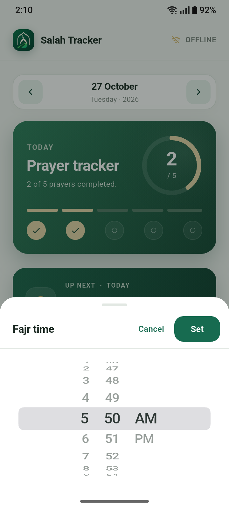
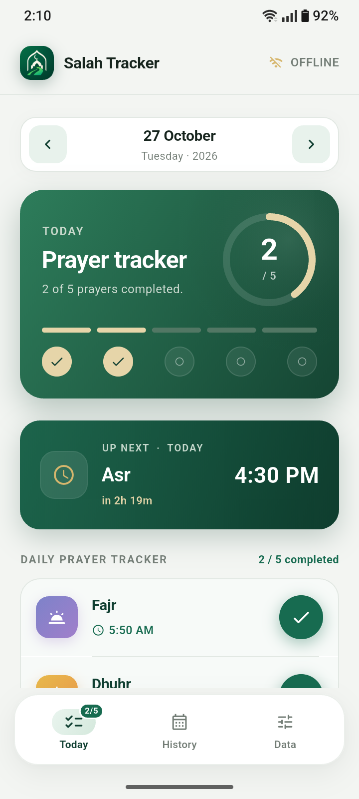
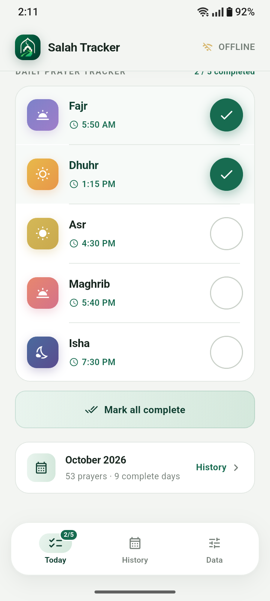
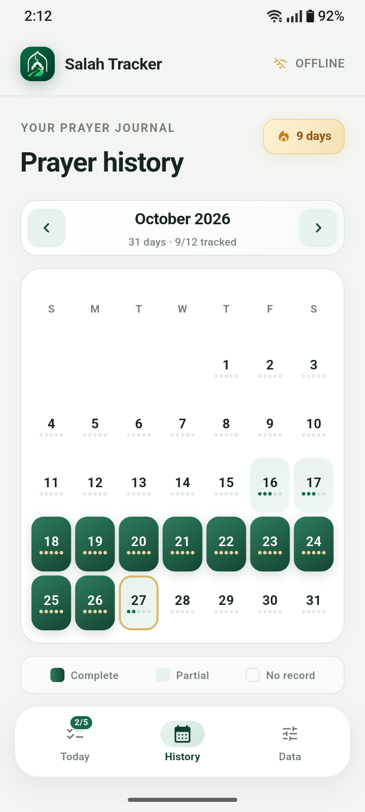
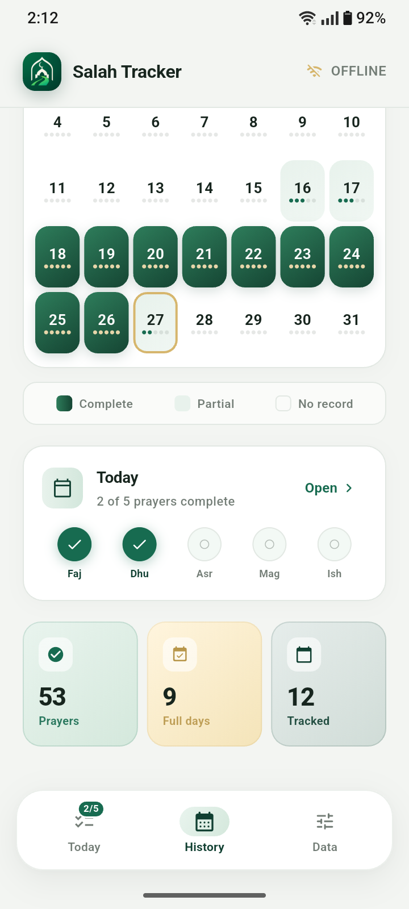
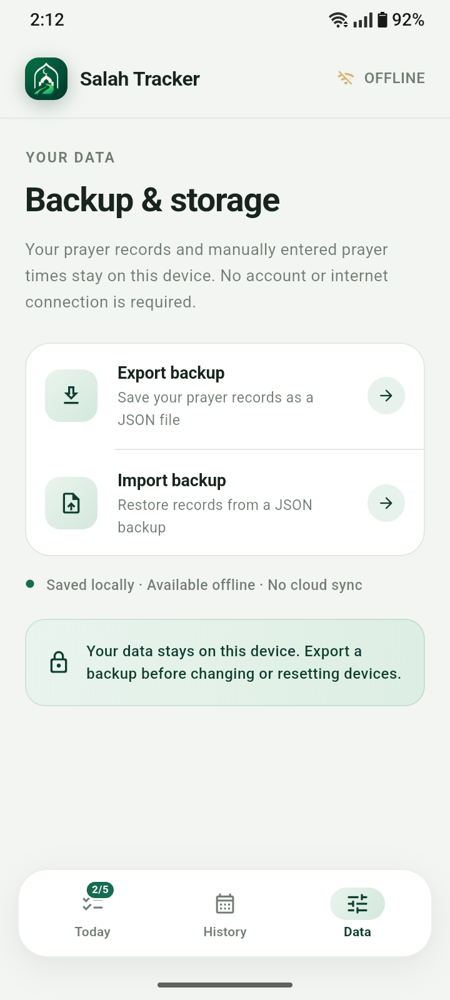

<div align="center">

# 🕌 Salah Tracker

### Track Your Salah. Build Consistency. Stay Connected.

A Flutter-based Salah tracking application designed to help users record daily prayers, manage prayer schedules manually, and review their prayer history and progress.

**Offline Tracking · Manual Prayer Schedule · Daily Progress**


</div>

---

## 📖 About the Project

**Salah Tracker** is a cross-platform application built with **Flutter and Dart** to help users maintain a consistent Salah-tracking routine.

The application allows users to track their daily Salah, manage prayer schedules manually, and review their prayer history and progress. Its offline tracking capability and local data storage make it useful without requiring a continuous internet connection for the core tracking workflow.

The project focuses on simplicity, usability, and a clean experience across supported platforms.

## ✨ Features

- 🕌 **Daily Salah Tracking** — Record daily prayer activity.
- 📅 **Manual Prayer Schedule** — Manage prayer schedules manually.
- 📊 **Progress Tracking** — Monitor daily Salah completion and progress.
- 📚 **Prayer History** — Review previously recorded prayer activity.
- 📵 **Offline Support** — Track Salah without requiring a continuous internet connection.
- 💾 **Local Data Storage** — Persist application data locally using SharedPreferences.
- 📱 **Cross-Platform Development** — Built with Flutter for Android, iOS, and Web.
- 🎯 **Simple User Experience** — Focused on making daily prayer tracking straightforward.

## 🖼️ Screenshots

Explore the Salah Tracker interface below.

### App Preview

<table>
  <tr>
    <td align="center" width="33%">
      
      <br/>
      <b>App Preview 01</b>
    </td>
    <td align="center" width="33%">
      
      <br/>
      <b>App Preview 02</b>
    </td>
    <td align="center" width="33%">
      
      <br/>
      <b>App Preview 03</b>
    </td>
  </tr>
  <tr>
    <td align="center" width="33%">
      
      <br/>
      <b>App Preview 04</b>
    </td>
    <td align="center" width="33%">
      
      <br/>
      <b>App Preview 05</b>
    </td>
    <td align="center" width="33%">
      
      <br/>
      <b>App Preview 06</b>
    </td>
  </tr>
</table>

## 🛠️ Built With

| Technology | Purpose |
|---|---|
| [Flutter](https://flutter.dev/) | Cross-platform application framework |
| [Dart](https://dart.dev/) | Application programming language |
| SharedPreferences | Local data persistence |
| [Git](https://git-scm.com/) | Version control |
| [GitHub](https://github.com/) | Source code hosting and collaboration |

## 📱 Supported Platforms

Salah Tracker is developed using Flutter for the following platforms:

- Android
- iOS
- Web

Actual platform availability depends on the current project configuration and successful platform-specific builds.

## 🚀 Getting Started

Follow these instructions to set up and run Salah Tracker on your local machine.

### Prerequisites

Install the following tools before getting started:

- [Flutter SDK](https://docs.flutter.dev/get-started/install)
- [Git](https://git-scm.com/)
- [Visual Studio Code](https://code.visualstudio.com/) or Android Studio
- An appropriate device, emulator, or configured browser

For iOS development, macOS and the required Apple development tools are generally necessary.

### 1. Clone the Repository

```bash
git clone https://github.com/rifathossain18/salah_tracker.git
```


### 2. Open the Project Directory

```bash
cd salah_tracker
```


### 3. Install Dependencies

```bash
flutter pub get
```

This command installs the dependencies specified in the Flutter project.

### 4. Verify the Development Environment

```bash
flutter doctor
```

Check the output and resolve any required setup issues for your target platform.

### 5. Run the Application

```bash
flutter run
```

Choose an available device or configured target when prompted.

## 🏗️ Build for Production

You can build the application for supported platforms using the following commands.

### Android APK

```bash
flutter build apk
```

The generated APK is typically available at:

```text
build/app/outputs/flutter-apk/app-release.apk
```

### Android App Bundle

```bash
flutter build appbundle
```

The generated bundle is typically available at:

```text
build/app/outputs/bundle/release/app-release.aab
```

### Web

```bash
flutter build web
```

The production web build is generated in:

```text
build/web/
```

### iOS

```bash
flutter build ios
```

An appropriate macOS environment and Apple development tools are required for iOS builds.

## 💾 Data Storage and Offline Usage

Salah Tracker uses **SharedPreferences** for local data persistence.

The current design supports offline Salah tracking and stores relevant data in the local application environment.

Please keep the following points in mind:

- Locally stored data is not automatically synchronized between devices.
- Clearing browser or application data may affect locally stored records.
- Uninstalling an application may remove its local data, depending on the platform.
- Cloud backup and cross-device synchronization should not be assumed to be available.

Users should preserve important records if the application does not provide a backup or export feature.

## 🔔 Prayer Reminders

Prayer reminders and notifications are planned for a future update. They are **not currently listed as an implemented feature**.

Future reminder functionality may help users receive notifications related to their prayer schedules.

## 🗺️ Roadmap

The following items represent potential improvements for future releases.

- [ ] Prayer reminders and notifications
- [ ] Enhanced prayer history and progress insights
- [ ] Improved tracking experience
- [ ] Additional usability enhancements
- [ ] Further cross-platform testing and refinements

Roadmap items may change as development progresses.

## 🤝 Contributing

Contributions, suggestions, and bug reports are welcome.

If you would like to contribute:

1. Fork this repository.
2. Create a new feature branch.
3. Make your changes.
4. Test your changes on the relevant platform.
5. Commit your changes with a descriptive message.
6. Open a pull request explaining your contribution.

For significant changes, consider opening an issue first to discuss the proposed improvement.

## 🐛 Issues and Feature Requests

Found a bug or have an idea for improvement?

Please open an issue in the repository and include:

- A clear description of the problem or suggestion
- Steps to reproduce the issue, when applicable
- Expected and actual behavior
- Platform and environment details
- Relevant screenshots or error logs, if available

Do not include passwords, access tokens, or other sensitive information in public issues.

## 🔒 Privacy and Data Handling

Salah Tracker is designed around local Salah tracking and local data persistence.

The use of local storage does not, by itself, establish the complete privacy or security characteristics of the application. Review the source code and dependencies to understand how data is handled.

No cloud synchronization or remote backup is claimed by this README.

## 📄 License

No open-source license has been specified in this README.

If you intend to distribute the project as open source, add an appropriate `LICENSE` file and update this section accordingly. Until a license is added, do not assume that the project is available for unrestricted reuse or redistribution.

## 👨‍💻 Developer

**Salah Tracker**

Built with ❤️ using Flutter and Dart.

If you find this project useful, consider giving the repository a ⭐ on GitHub.

---

<div align="center">

**Salah Tracker - Rifat**

*One day at a time. One prayer at a time.*

</div>
